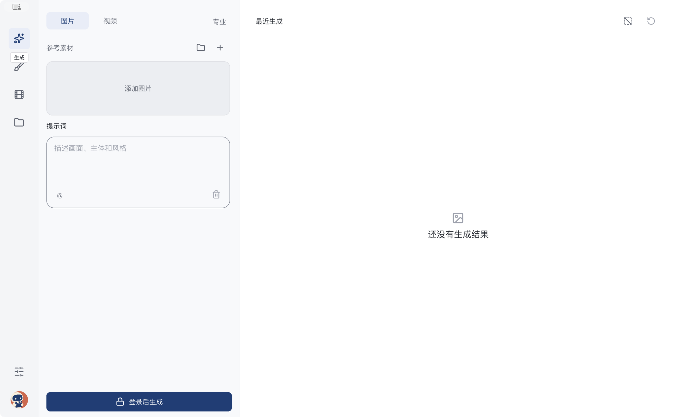
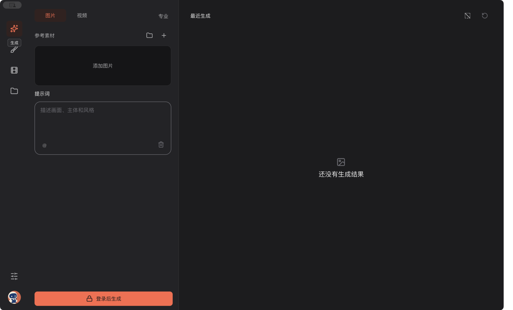
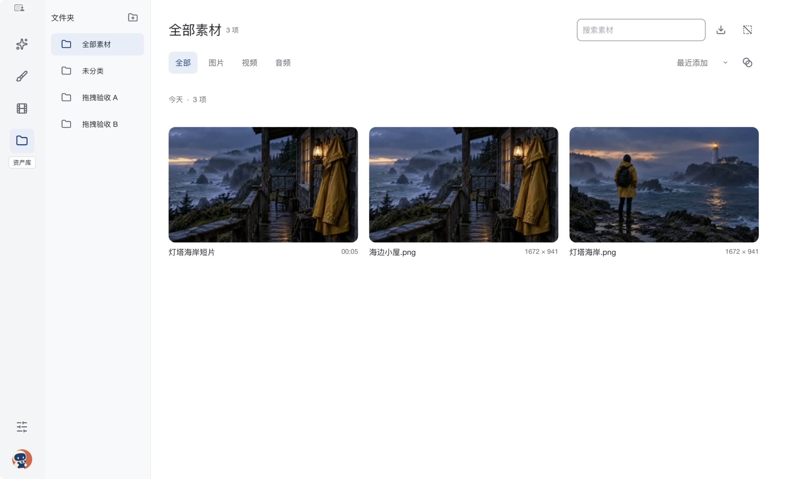
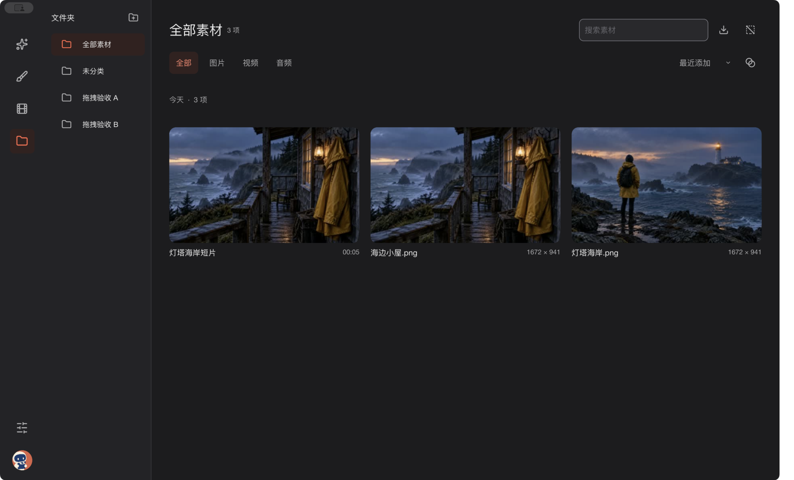
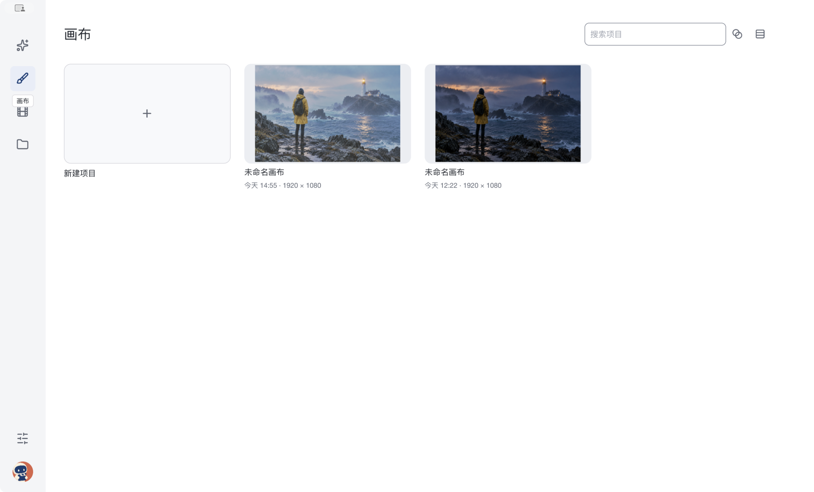
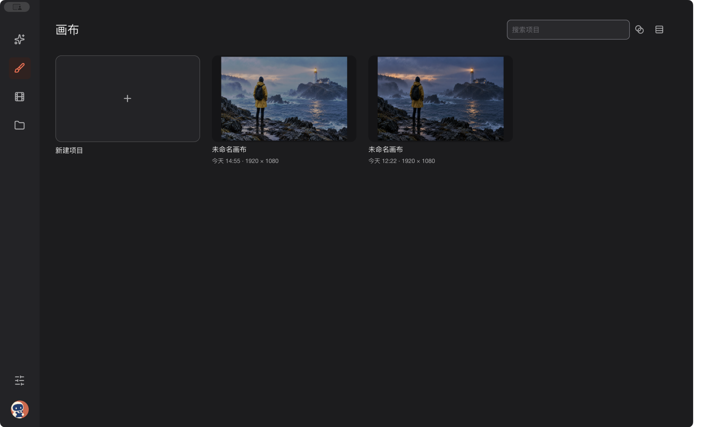
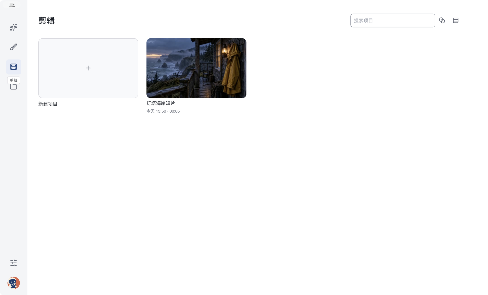
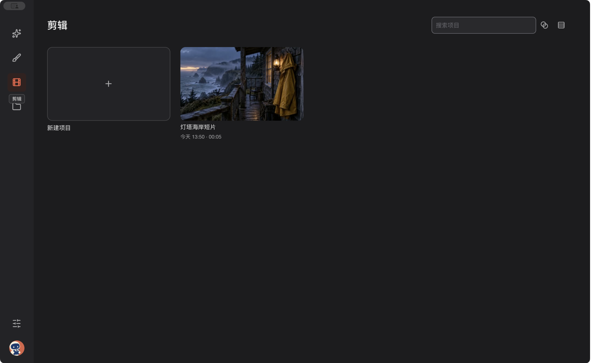

<div align="center">


# SeeCut

#### 一站式音视频创作应用

从 AI 生成、图片设计到音频处理、视频剪辑，在一个应用里完成创作。

[](https://github.com/Stormycry-cryp/seecut/tree/codex/seecut-unified-mac-candidate/src)
[](https://slint.dev)
[](LICENSE)


[简体中文](README.md) · [English](README.en.md) · [开发分支](https://github.com/Stormycry-cryp/seecut/tree/codex/seecut-unified-mac-candidate) · [反馈问题](https://github.com/Stormycry-cryp/seecut/issues)

</div>

SeeCut 把图像、音频和视频创作放进同一个桌面应用。你可以从一句提示词、一张参考图或一组本地素材开始，生成需要的内容，编辑图片与图层，再加入配音、音乐和字幕，剪成完整的视频。

它希望让素材从生成、整理、修改到成片导出，沿着同一条创作流程继续使用。临时做一张封面、改一张商品图，或者完整制作一条短视频，都可以从各自最方便的入口开始。

---

## 你可以用它做什么

| 创作环节 | 可以做的事 |
| --- | --- |
| **AI 生成** | 从提示词和参考素材生成图片、视频，使用快速模式或专业参数继续调整。 |
| **图片设计** | 导入图片和支持的分层 PSD，在原生画布中编辑图层、文字、调整层和蒙版，制作封面与视觉素材。 |
| **音视频剪辑** | 在多轨时间线上组织视频、配音和音乐，完成分割、裁切、转场、调速与音量调整。 |
| **字幕与配音** | 使用语音转字幕、本地文字转语音等工具，为视频补充文字与声音。 |
| **资产管理** | 整理本地素材和生成结果，按文件夹查找，并送到画布、Flow 或剪辑工程继续使用。 |
| **Flow 与 Agent** | 用节点组织创作步骤；让 Agent 在应用授权范围内读取工作区、调用已接入的编辑和任务工具。相关能力仍在持续完善。 |

本地素材管理、图片画布和音视频剪辑可离线使用。在线 AI 生成需要登录并连接服务，可用模型和费用以应用内显示为准；本地字幕和配音工具需要相应模型文件。

## 看看界面

以下展示 macOS 候选版本的生成、资产库、画布和剪辑界面，支持浅色与深色主题。截图使用公开演示素材；生成页为未登录状态。

| 浅色 | 深色 |
| --- | --- |
|  |  |
|  |  |
|  |  |
|  |  |

## 一条创作流程

比如，你要制作一条产品短视频：

1. **准备素材**：导入商品图、拍摄片段、配音或音乐，也可以先生成需要的图片和视频。
2. **修改画面**：在图片画布里处理图层、文字、颜色与蒙版，准备封面和需要用到的视觉素材。
3. **整理和复用**：把素材保存在资产库，送到对应工作区继续制作；需要多步生成时，可以在 Flow 中组织节点。
4. **剪成视频**：安排时间线，加入声音和字幕，调整节奏、转场和音量，最后导出。

也可以直接打开图片画布做一张图，或导入已有片段开始剪辑。

---

## 当前进展

SeeCut 正在开发中，目前主要在 **macOS Apple Silicon** 上构建和验证。其他平台的 SeeCut 版本仍需实机验收，当前仓库尚未提供公开下载包。

最新 SeeCut 源码位于 [`codex/seecut-unified-mac-candidate`](https://github.com/Stormycry-cryp/seecut/tree/codex/seecut-unified-mac-candidate)。仓库默认分支目前保留 Concat 初始基线，体验和构建 SeeCut 请使用开发分支。

功能验证与已知限制见开发分支的[实现核对记录](https://github.com/Stormycry-cryp/seecut/blob/codex/seecut-unified-mac-candidate/docs/SEECUT-FIGMA-IMPLEMENTATION-QA.md)。

## 从源码开始

macOS 原生应用需要 Rust 1.93、Xcode Command Line Tools、CMake、C++ 工具链和 FFmpeg 7+ 开发库。

```sh
git clone --branch codex/seecut-unified-mac-candidate --single-branch https://github.com/Stormycry-cryp/seecut.git
cd seecut/src
cargo run --profile quick -p concat
```

Flow 的 Web 工作区和本地服务需要另外准备 Bun 与 Toonflow 资源；完整 Agent 功能也需要配套运行时。原生应用构建与完整功能打包的准备方式分别见[源码说明](https://github.com/Stormycry-cryp/seecut/blob/codex/seecut-unified-mac-candidate/src/README.md)、[Flow 集成说明](https://github.com/Stormycry-cryp/seecut/blob/codex/seecut-unified-mac-candidate/integrations/toonflow/SOURCE.md)和 [Agent 组件打包说明](https://github.com/Stormycry-cryp/seecut/blob/codex/seecut-unified-mac-candidate/docs/SEECUT-AGENT-FLOW.md#local-macos-bundle)。

## 反馈与参与

欢迎提交 [Issue](https://github.com/Stormycry-cryp/seecut/issues) 或 PR，分享创作需求、使用体验和具体问题。报告问题时，请附上复现步骤、系统版本，以及可脱敏的截图或日志。

## 致谢与许可

SeeCut 基于 [Concat](https://github.com/jub0t/Concat) 的 Rust 与 Slint 桌面应用开发，保留上游作者及贡献者声明。部分图片画布实现移植自 Robbie Tilton 的 [Compositor](https://github.com/robbietilton/Compositor)；Flow 工作区集成自 [Toonflow](https://github.com/HBAI-Ltd/Toonflow-app)。感谢这些项目提供的基础。

本仓库代码沿用 [AGPL-3.0-or-later](LICENSE)。附加授权见 [LICENSE-EXCEPTIONS.md](LICENSE-EXCEPTIONS.md)，第三方声明见 [THIRD_PARTY_NOTICES.md](THIRD_PARTY_NOTICES.md)；Compositor 和 Toonflow 的相关部分保留各自 MIT 许可。
